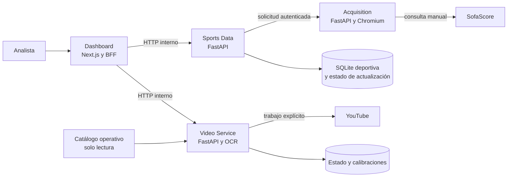

# Arquitectura

Real Jaén Analytics está formada por cuatro servicios. El navegador solo utiliza el Dashboard; las APIs de datos, adquisición y vídeo se comunican por redes privadas de Docker.

## Responsabilidades

### Dashboard

Aplicación Next.js con la interfaz de preparación, partidos, equipos y jugadores. Su BFF sirve las rutas `/api/v1`, aplica la sesión de acceso y traduce las peticiones del navegador a los contratos internos. El Dashboard no abre SQLite deportiva ni consulta SofaScore directamente.

El flujo de vídeo también pasa por el BFF: resuelve el partido, transforma los comentarios disponibles al contrato neutral de eventos y llama a Video Service. Las escrituras requieren una sesión con permiso de actualización.

### Sports Data

API FastAPI que posee la base deportiva SQLite. Resuelve partidos, temporadas, equipos, jugadores, alineaciones, estadísticas y comentarios narrativos. También mantiene las generaciones publicadas, el estado de las actualizaciones y su procedencia.

Cuando se solicita una actualización, Sports Data prepara la receta y el inventario conocido, y es el único servicio que decide si un paquete validado puede publicarse en SQLite.

### Acquisition

Servicio FastAPI interno que ejecuta la receta aprobada mediante el SDK y un navegador Chromium gestionado. Recibe solicitudes de Sports Data, usa un perfil persistente propio y entrega un paquete verificable. No monta ni consulta la base deportiva.

Acquisition permanece a la espera cuando no hay trabajos; arrancar el contenedor no inicia una adquisición.

### Video Service

API FastAPI independiente para referencias de YouTube, trabajos explícitos de calibración y resolución de posiciones de reproducción. Usa OCR para leer referencias del reloj futbolístico y construir segmentos de sincronización. No consulta Sports Data ni abre su base SQLite.

El catálogo operativo de vídeos se monta en solo lectura. El estado del servicio y las calibraciones generadas tienen almacenamiento propio.

## Comunicación y aislamiento

- Dashboard → Sports Data: consultas y control autenticado de actualizaciones por HTTP interno.
- Sports Data → Acquisition: solicitud de captura, consulta de estado y descarga de paquetes por HTTP autenticado en una red interna.
- Dashboard → Video Service: referencias, contratos de eventos y peticiones de sincronización por HTTP interno.
- Acquisition y Video Service tienen salida de red para las operaciones que les corresponden. Sports Data no contiene navegador ni código de adquisición.
- Solo el Dashboard publica un puerto en el host: `127.0.0.1:33201` por defecto en desarrollo y `0.0.0.0:8120` en el ejemplo de producción. Los otros tres servicios no publican puertos externos.

El contrato entre Sports Data y Acquisition está descrito en [contrato-adquisicion-interno.md](../sports-data/docs/contrato-adquisicion-interno.md). Las notas de cada componente están en los [README del Dashboard](../dashboard/README.md), [Sports Data](../sports-data/README.md) y [Video Service](../video-service/README.md).

## Persistencia

- **Sports Data:** `real-jaen.sqlite` y el estado de coordinación de actualizaciones viven en el volumen `rja-dev-sports-state` en desarrollo. El servicio es el único propietario de esa base.
- **Acquisition:** el perfil del navegador y el historial de trabajos se conservan en volúmenes propios (`rja-dev-acquisition-profiles` y `rja-dev-acquisition-jobs`). No se comparte el perfil con otras instalaciones.
- **Video Service:** su SQLite y estado persistente usan `rja-dev-video-state`. El catálogo operativo se monta por separado y en solo lectura.
- **Dashboard:** el volumen `rja-dev-dashboard-next` conserva artefactos de desarrollo; no contiene la base deportiva.

Los nombres de producción se configuran en `.env.prod.example`. Mantener la misma identidad de proyecto y los mismos nombres de volumen permite actualizar imágenes sin sustituir los datos.
